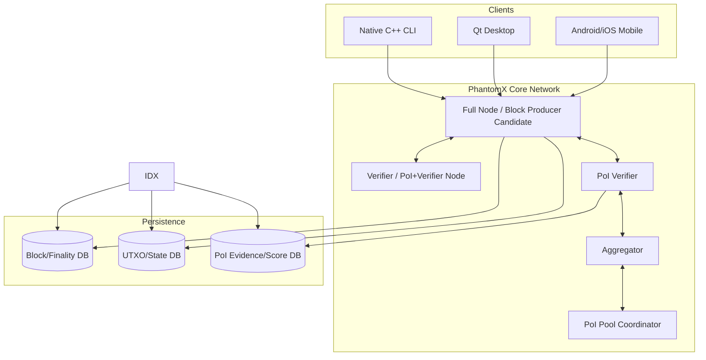
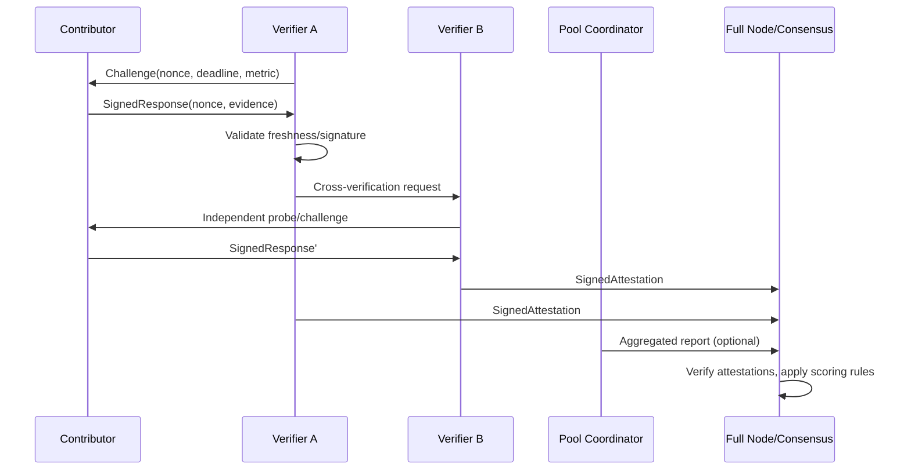
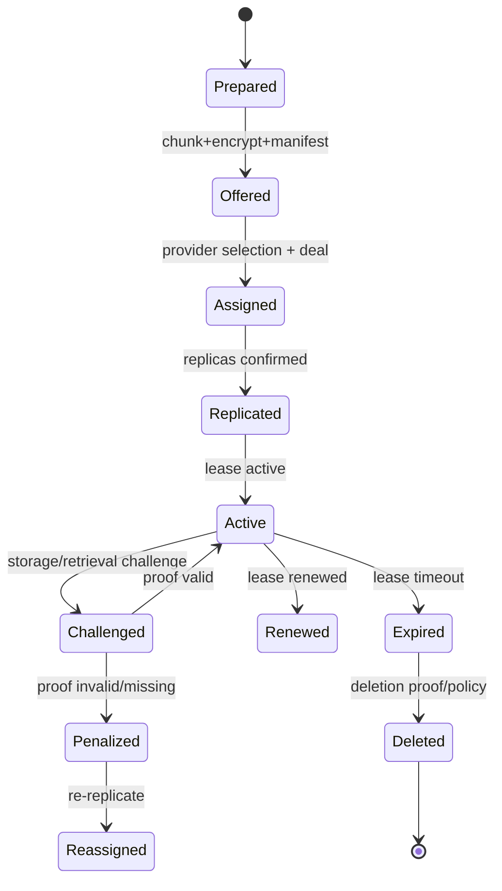

# PHANTOMX ARCHITECTURE

> **NOTE (PoI+Verifier removed):** PhantomX consensus/finality has moved to **PoI + Verifier attestation**. Any remaining PoI+Verifier/verifier wording in this document is historical and must not be used to reintroduce PoI+Verifier.


## 1. Architecture Overview

PhantomX (PHX) is an independent Layer 1 blockchain with three coordinated subsystems:

1. **PoI Contribution Network** — measures real internet contribution (bandwidth, uptime, latency, relay) using challenge-response, nonce, signed evidence, freshness, and independent verification.
2. **PoI+Verifier Finality Consensus** — orders UTXO blocks and finalizes them with quorum certificates; PoI influences eligibility/contribution scoring, not Sybil resistance by itself.
3. **Decentralized HDD Storage Network** — stores real user files with encryption, chunking, content addressing, replication, challenges, retrieval proofs, and fee settlement.



## 2. Design Principles

- **Deterministic consensus:** integer arithmetic in smallest PHX unit; no floating point in consensus decisions.
- **Evidence-based PoI:** no measurement accepted without challenge-response, nonce, signed evidence, freshness window, and independent verification.
- **No storage mining in initial scope:** no reward for empty HDD capacity, no storage marketplace, and no storage reward in block subsidy.
- **Separation of identities/keys:** node identity, wallet key, verifier identity, verifier identity, and aggregator identity are distinct.
- **Explicit trust boundaries:** PoI is not Sybil-resistant; pools cannot self-verify; voting power not based on account count.
- **Security claims require tests:** no untested security claim is considered complete.

## 3. Identity and Key Model

| Identity | Purpose | Key type (recommended) | Storage | Exposure rules |
|---|---|---|---|---|
| Node identity | P2P authentication, peer reputation, node messages | Ed25519 or secp256k1 node key | Node keystore | Never shared; rotate with on-chain/node record update |
| Wallet key | Spend UTXO, sign transactions | BIP32/BIP39-derived spend keys, transparent UTXO | Wallet keystore/hardware-backed where possible | Never exposed via RPC/logs/UI telemetry |
| Verifier consensus key | PoI+Verifier proposals/votes/QCs | BLS12-381 or Ed25519 (final choice in protocol spec) | Verifier HSM/keystore | Separate from wallet; slashing/equivocation evidence bound to this key |
| PoI verifier identity | Sign challenge assignments and verification attestations | Ed25519/BLS verifier key | Verifier keystore | Must be registered; cannot be same as pool self-verification authority |
| Storage provider identity | Register provider, sign storage contracts/proofs | Ed25519 provider key | Provider keystore | Separate from wallet spend key; may map to payout address by signed declaration |

**Rules:**
- IP address is never the sole identity.
- Every role can have a payout wallet address, but role keys must be distinct.
- All signed evidence includes domain separation tag, chain ID/network ID, timestamp/slot/nonce, and signer identity.

## 4. Ledger and Tokenomics

### 4.1 Units

- Token: **PHX**
- Decimal: **8**
- Smallest unit: **phx_atom** (`1 PHX = 100,000,000 phx_atom`)
- All consensus/state values use integer `uint64`/checked 128-bit intermediate arithmetic.

### 4.2 Address Format

PhantomX user-facing addresses use the **`PhantomX`** prefix.

| Item | Value | Notes |
|---|---|---|
| Address brand prefix | `PhantomX` | Product/user-facing brand; canonical encoded address strings use bech32m HRP |
| Canonical HRP | `phantomx` (mainnet), `tphx` (testnet), `rphx` (regtest) | Bech32m HRP is lowercase in canonical form |
| Address scope | Wallet receive/payment addresses | Role identities may use separate encoded forms, but user-facing payout/receive addresses use this scheme |
| Encoding | bech32m (foundation/proposed) | Version byte + payload, 8-to-5 bit conversion, bech32m checksum; final mainnet lock still requires ADR/test vectors sign-off |
| Validation | Deterministic | Invalid HRP, charset, checksum, version, payload, or network must be rejected before signing/broadcast |
| Privacy/safety | No key material in address | Address is derived from public key/script hash; private keys never exposed |

**Canonical example:** `phantomx1qqqqsyqcyq5rqwzqfpg9scrgwpugpzysnazx7fn`

### 4.3 Supply and Emission

- Initial block reward: **25 PHX** = `2,500,000,000 phx_atom`
- Halving interval: **2,100,000 blocks**
- Target block time: **60 seconds**
- Premine: **0**
- Theoretical max supply: **105,000,000 PHX** = `10,500,000,000,000,000 phx_atom`

Block subsidy by height `h` (0-based or 1-based must be fixed in genesis spec; recommendation: height 1 first mined block):

```text
era = floor((h - 1) / 2_100_000)
subsidy = 2_500_000_000 >> era   (in phx_atom)
if era >= 64 or subsidy == 0: subsidy = 0
```

### 4.4 Block Subsidy Allocation

For each block subsidy `S`:

| Recipient class | Share | Amount |
|---|---:|---|
| PoI contributors | 70% | `S * 70 / 100` |
| Verifier operators | 20% | `S * 20 / 100` |
| Pool operators | 10% | `S * 10 / 100` |

**Rounding rule:** integer division in phx_atom; remainder assigned deterministically (recommendation: to PoI contributors bucket, then verifiers, then pools by fixed order) and recorded in block accounting. Consensus tests must cover remainder cases.

### 4.5 Storage Fees

- Storage providers are paid from **user storage fees**, not block subsidy.
- Storage fee settlement is a separate ledger flow: client/deal escrow -> payment schedule/retrieval proofs/storage proofs -> provider payout + protocol fee (if any, explicitly defined later).
- Block subsidy and storage fees must be accounted in separate fields.

## 5. PoI Architecture

### 5.1 Goal

PoI measures useful internet contribution for eligibility/contribution scoring. It is **not** Sybil-resistant and must be combined with PoI+Verifier verifier rules, identity/rate limits, and stake/bond/reputation policies where appropriate.

### 5.2 Metrics and Weights

| Metric | Weight | Evidence |
|---|---:|---|
| Bandwidth | 30% | Verifier-issued challenge data transfer, throughput/volume proof, signed receipts |
| Uptime | 25% | Scheduled liveness challenges over windows, signed probe results |
| Latency | 20% | RTT challenge-response with nonce/timestamp bounds |
| Relay | 25% | Relayed message delivery proofs, third-party acknowledgements, anti-loop checks |

Total score: `0..100`, fixed-point integer calculation (e.g., basis points internally).

```text
score_bp = bw_bp*30 + up_bp*25 + lat_bp*20 + relay_bp*25  // normalized basis points
score = clamp(score_bp / 10000, 0, 100)
```

### 5.3 PoI Evidence Requirements

All measurements require:

- **Challenge-response:** verifier issues unpredictable challenge.
- **Nonce:** unique per challenge; prevents replay.
- **Signed evidence:** contributor signs response; verifier signs observation/attestation.
- **Freshness:** timestamp/slot window; stale evidence rejected.
- **Independent verification:** no single pool or contributor self-attests final score; verifier quorum/cross-verification required.

### 5.4 PoI Flow



### 5.5 Anti-Abuse Controls

- Pool cannot self-verify contributions.
- Verifiers are randomly assigned/rotated and rate-limited.
- Evidence must include network path diversity where possible; IP is metadata, not identity.
- Duplicate nonce/replay/equivocation blacklisted with evidence.
- Score caps per identity/window; anomaly detection flags but consensus only uses deterministic rules.

## 6. PoI+Verifier Finality Architecture

### 6.1 Consensus Shape

PhantomX uses a hybrid model:

- **PoI:** determines eligibility/contribution score and reward accounting inputs.
- **PoI+Verifier:** provides deterministic finality for blocks/UTXO state.

This is not PoSpace, not VDF/PoT, and not Nakamoto-only probabilistic finality.

### 6.2 Roles

- **Proposer:** selected for slot/height/round from eligible verifier set.
- **Verifiers:** verify block, PoI commitments, storage settlement commitments, and vote.
- **Full nodes:** verify blocks/QCs and maintain UTXO/storage metadata state.

### 6.3 Verifier Eligibility

A verifier is eligible if it satisfies protocol-defined rules, e.g.:

- Registered verifier identity key and node identity.
- Minimum bond/stake or protocol-defined security deposit (amount TBD by economic spec; must be deterministic).
- No active slashing/equivocation penalty preventing participation.
- Meets minimum uptime/availability requirements over recent windows.
- PoI score may be used as an eligibility threshold or weight input, but **not** as Sybil resistance proof.

### 6.4 Voting Power

Voting power must **not** be based on account count. Recommended deterministic formula:

```text
vp_i = bond_weight_i + poi_weight_i_cap + reputation_weight_i_cap
```

Where all components are integer-scaled, capped, and protocol-fixed. Exact caps/weights require simulation before mainnet. An alternative is pure bonded stake for PoI+Verifier safety and separate PoI reward distribution; this is safer unless PoI-weighted PoI+Verifier is formally proven.

### 6.5 Proposer Selection

Deterministic proposer selection per round:

```text
seed_r = H(prev_qc_hash || round || epoch_randomness)
proposer = weighted_select(eligible_validator_set, seed_r)
```

`epoch_randomness` must be unpredictable before commitment and unbiasable within protocol assumptions; use PoI+Verifier commit-reveal/aggregate signature randomness or finalized-block randomness rules defined in a dedicated spec.

### 6.6 Quorum and Quorum Certificate

- Committee size `N`.
- Quorum threshold `Q = floor(2N/3) + 1` voting power (or count only if voting power is uniform; prefer voting power).
- A **Quorum Certificate (QC)** aggregates votes for `(block_hash, height, round, phase)`.
- Block is **finalized** when commit QC is observed by node under safety rules.

### 6.7 Timeout, View Change, Equivocation

- **Timeout:** if proposal/pre-vote/pre-commit not observed within `Δ`, verifier emits timeout/vote for round change.
- **View change:** round `r+1` proposer collects timeout evidence and proposes according to safe-lock rules.
- **Equivocation:** conflicting signed votes/proposals for same height/round/phase by same verifier key are slashable and broadcast as evidence.

### 6.8 Verifier Rotation and Recovery

- Rotation at epoch boundaries based on finalized state.
- Join/leave/rotation requests become active only after finality and activation delay.
- Recovery: nodes resync from finalized checkpoints/QCs; state replay must reproduce identical UTXO root and consensus metadata.

### 6.9 Safety and Liveness Assumptions

| Property | Assumption |
|---|---|
| Safety | < 1/3 voting power Byzantine/faulty; cryptographic signatures/hash functions secure; deterministic execution |
| Liveness | Partial synchrony after GST; sufficient honest proposers/verifiers online; network delivery within bounded unknown delay eventually |
| PoI integrity | Measurement validity depends on verifier diversity, freshness, and independent verification; PoI alone not Sybil-resistant |
| Storage availability | Depends on replication, challenge cadence, and economic incentives; not guaranteed by consensus alone |

## 7. Storage Network Architecture

### 7.1 Storage Principles

- Real file storage, not Proof of Space.
- No reward for empty HDD capacity.
- Rewards/fees tied to data actually stored and retrievable.
- User files are client-side encrypted before leaving owner device unless user explicitly opts out.

### 7.2 Storage Lifecycle



### 7.3 Required Storage Functions

| Function | Description | Consensus/state impact |
|---|---|---|
| Chunking | Split file into fixed/max-size chunks; deterministic chunk IDs | Manifest commitment on-chain/off-chain anchored |
| Content addressing | CID/hash per chunk and manifest root | Integrity and dedup reference |
| Client-side encryption | Encrypt chunks before upload; keys owned by user | No plaintext on providers by default |
| Provider registration | Provider registers identity, capacity commitment metadata, endpoint, bond | On-chain provider record |
| Assignment | Match deals to providers by policy/replication | Deal/assignment records |
| Replication | Maintain N replicas across failure domains | Replica set tracked |
| Lease | Time-bound storage agreement | Lease expiry and renewal |
| Storage challenge | Random challenge proving data possession/retrievability | Proof verification and penalties/rewards |
| Retrieval challenge | Verify data can be served through retrieval path | Availability/payment signal |
| Integrity verification | Hash/Merkle proof against manifest | Reject corrupt data |
| Storage fee | User pays fee for storage/retrieval | Escrow/accounting |
| Payment settlement | Periodic settlement from escrow/fees to providers | Transparent ledger events |
| Expiration | Lease ends; access/obligation rules apply | State transition |
| Deletion | Delete according to policy; issue deletion attestation where possible | Metadata/state update |

### 7.4 Reward and Fee Model

- Block subsidy is allocated by consensus/tokenomics rules (Contributor/Verifier/Pool Operator).
- Transaction fees follow integer `phx_atom` accounting and are handled separately from PoI scoring.
- No storage-provider payment model is included in the initial scope.

## 8. Node Roles and Responsibilities

| Role | Responsibilities | Key inputs | Outputs |
|---|---|---|---|
| Full Node | Validate blocks/tx, relay P2P, maintain UTXO/finality state | Blocks, txs, QCs, evidence commitments | Validated chain state, RPC |
| Verifier/PoI+Verifier Node | Propose/vote/finalize blocks | Eligible verifier set, mempool, PoI/storage commitments | Proposals, votes, QCs |
| PoI Verifier | Issue challenges, verify responses, cross-verify, sign attestations | Contributor endpoints, schedules, randomness | Signed PoI attestations |
| Pool Coordinator | Aggregate contributor reporting, payout coordination | Contributor evidence, pool policy | Pool reports, payout instructions; cannot self-verify |
| Aggregator | Collect verifier attestations, build verifiable certificates | Verifier attestations, assignments | Aggregation certificates, dispute records |

## 9. Data and Interface Boundaries

### 9.1 Internal Modules (C++ Core)

- `core/types`: canonical serialization, hashes, IDs, units.
- `core/utxo`: UTXO set, tx validation, coin selection helpers.
- `core/consensus`: PoI+Verifier state machine, QC verification, fork choice/finality.
- `core/poi`: challenge protocol, evidence verification, scoring.
- `core/storage`: deal/lease/proof/settlement state machines.
- `core/p2p`: peer discovery, gossip, request/response.
- `core/rpc`: authenticated/public APIs.
- `core/persistence`: DB adapters, migrations, snapshots.

### 9.2 Public Interfaces

- **CLI:** node ops, wallet, verifier, verifier, pool, diagnostics.
- **Qt Desktop:** wallet, node status, PoI/storage dashboards.
- **Mobile:** light wallet/monitoring; no verifier/storage-provider heavy duties by default.

## 10. Observability and Auditability

- Every consensus decision must be reproducible from block data, evidence commitments, and deterministic rules.
- PoI and storage proofs should have audit logs with signed evidence references.
- Metrics: block time, finality latency, fork/reorg count, PoI verification pass rate, storage challenge pass rate, retrieval latency.

## 11. MVP Boundaries

**MVP should include:**
- Transparent UTXO ledger, basic transfers, fee model.
- PoI+Verifier finality with fixed verifier set/bootstrap rules.
- PoI evidence ingestion and scoring with independent verifier attestations (limited scale).
- Storage registration, deal creation, chunk storage, basic storage/retrieval challenges, fee settlement.
- CLI + basic Qt wallet/node UI.

**Post-MVP:**
- Advanced verifier rotation/economics/slashing.
- Large-scale verifier assignment randomness and anti-collusion.
- Retrieval markets, bandwidth markets, erasure coding, repair automation.
- Mobile light-client proofs and hardware-wallet integrations.