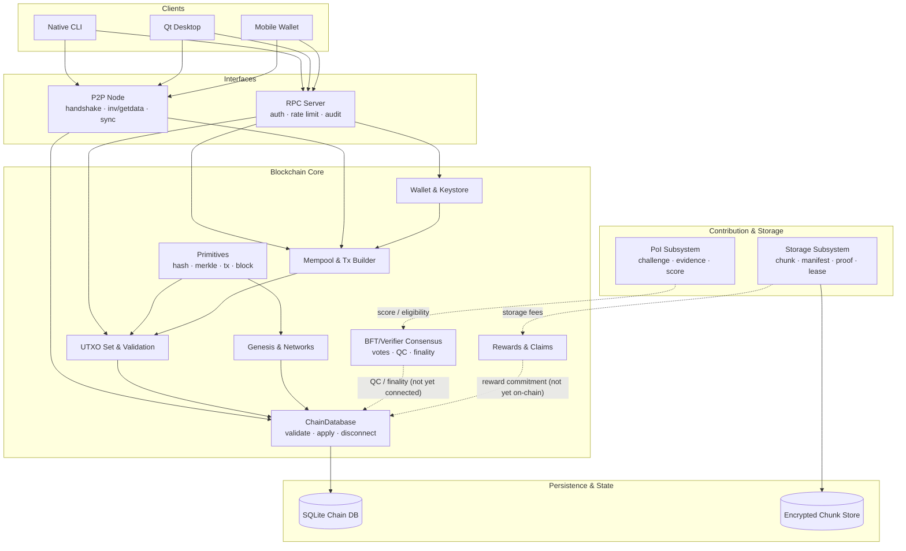
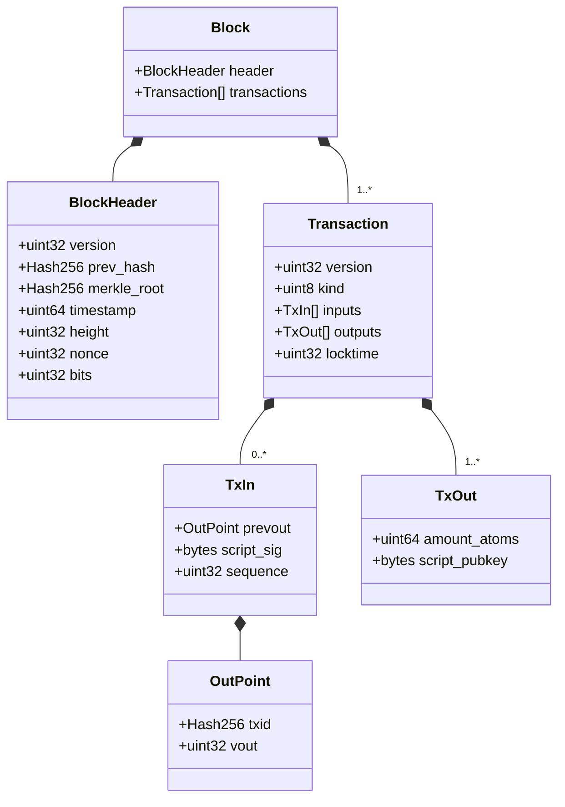
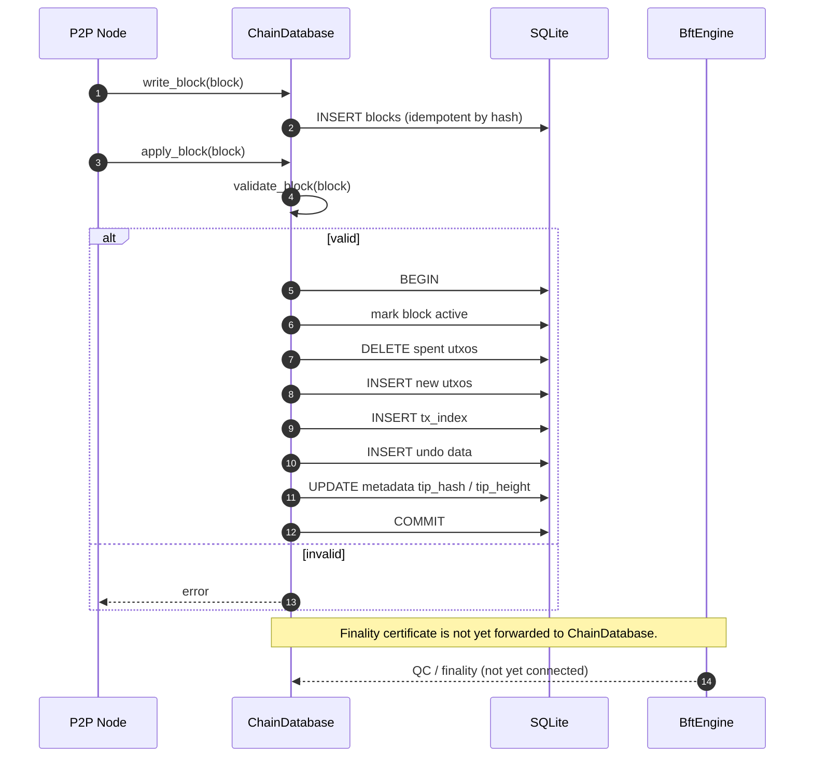
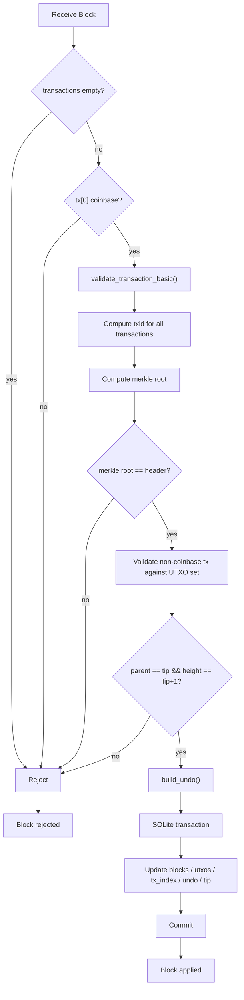
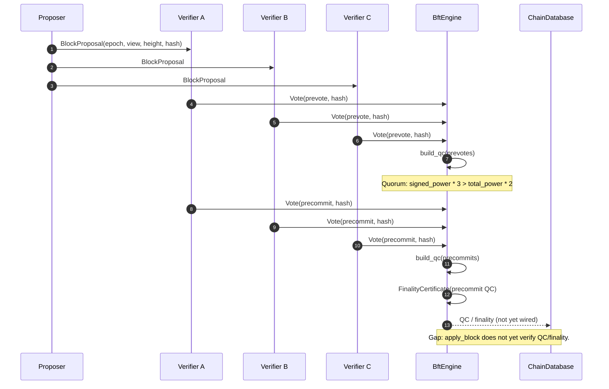
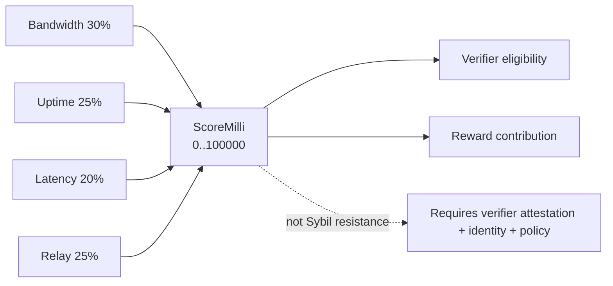
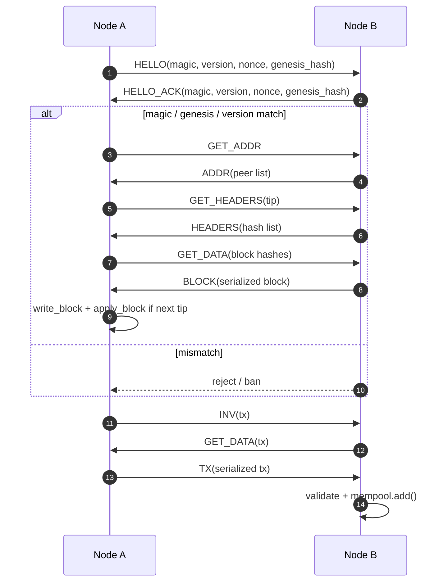
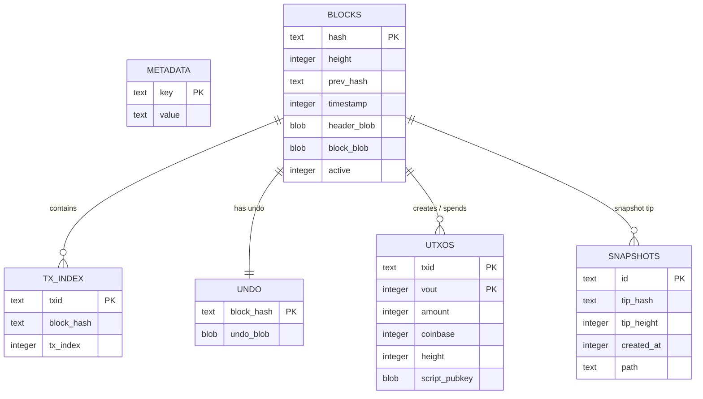
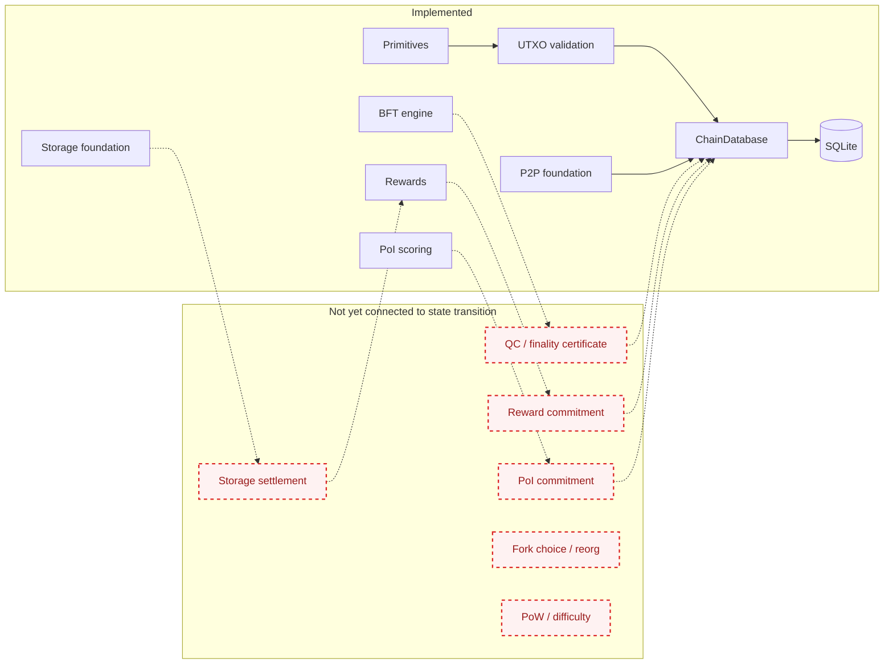

# PhantomX Architecture Diagram

> **NOTE (PoI+Verifier removed):** PhantomX consensus/finality has moved to **PoI + Verifier attestation**. Any remaining PoI+Verifier/verifier wording in this document is historical and must not be used to reintroduce PoI+Verifier.

This document contains PhantomX architecture diagrams based on the implementation in `include/phantomx/`, `src/`, and `docs/`.

- **Diagram source:** Mermaid diagram below (image assets not included in this directory).
- **Status:** foundation/prototype, not production-ready.
- **Legend:**
  - Solid line = implemented flow.
  - Dashed red line = integration gap / not yet connected to chain.
  - Dashed amber line = PoI signal to verifier eligibility.
  - Dashed teal line = storage settlement flow (separate from block subsidy).

---

## 1. Layered architecture

Mermaid version:



---

## 2. Block and transaction data structure



### Block layout v1

```text
Block
├── header (104 bytes)
│   ├── version        u32
│   ├── prev_hash      hash256 (length-prefixed)
│   ├── merkle_root    hash256 (length-prefixed)
│   ├── timestamp      u64
│   ├── height         u32
│   ├── nonce          u32
│   └── bits           u32
└── transactions
    ├── tx_count       u32
    └── tx[0..n]       length-prefixed serialized transactions
```

Hash rules:

```text
txid        = SHA-256d(serialize_transaction(tx))
block_hash  = SHA-256d(serialize_block_header(header))
merkle_root = SHA-256d(left || right), odd node duplicated
```

---

## 3. Block lifecycle



### Validation and apply flow



---

## 4. PoI + Verifier attestation consensus



### Key rules

```text
eligible verifier = identity_verified && !slashed && poi_score >= min_poi_score
voting_power       = clamp(poi_score, caps)
quorum             = floor(2 * total_power / 3) + 1
proposer           = weighted_select(verifiers, SHA-256d(epoch || view || pubkeys))
finality           = precommit QC
```

### PoI scoring



---

## 5. P2P network



### P2P frame

```text
network_magic(u32) | type(u8) | reserved(u8) | payload_len(u32) | checksum(u32) | payload
checksum = first 4 bytes of SHA-256d(payload)
max payload = 2 MiB
```

---

## 6. Chainstate database



Notes:
- `metadata` stores `tip_hash`, `tip_height`, `network`, and `finalized_height`.
- `blocks.active` marks blocks on the active chain.
- `undo` is used for `disconnect_block`.
- UTXO state is **not** committed to the block header.

---

## 7. Component integration status



---

## 8. Main flow summary

```text
Client
  └── RPC / P2P
        ├── Transaction
        │     └── UTXO validation → Mempool
        └── Block
              └── ChainDatabase.validate_block()
                    ├── merkle root check
                    ├── UTXO contextual check
                    └── apply_block()
                          ├── spend inputs
                          ├── create outputs
                          ├── write tx index
                          ├── write undo
                          └── advance tip

Consensus
  └── PoI score → verifier eligibility → BFT votes → QC → finality certificate
        └── (not yet forwarded to ChainDatabase)

Storage
  └── chunk + encrypt → manifest → replication → lease → proof → settlement
        └── (not yet fully on-chain)
```

---

## 9. Main source files

| Area | File |
|---|---|
| Block & header | `include/phantomx/primitives/block.hpp`, `src/primitives/block.cpp` |
| Transaction | `include/phantomx/primitives/transaction.hpp`, `src/primitives/transaction.cpp` |
| Hash & Merkle | `src/primitives/hash.cpp`, `src/primitives/merkle.cpp` |
| UTXO & validation | `include/phantomx/utxo/utxo.hpp`, `src/utxo/validation.cpp` |
| Mempool & tx builder | `include/phantomx/utxo/mempool.hpp`, `src/utxo/tx_builder.cpp` |
| Chain database | `include/phantomx/blockchain/chain.hpp`, `src/blockchain/chain.cpp` |
| Genesis | `src/blockchain/genesis.cpp`, `config/*.json` |
| Consensus/BFT | `include/phantomx/consensus/bft.hpp`, `src/consensus/bft.cpp` |
| PoI | `include/phantomx/poi/`, `src/poi/` |
| Storage | `include/phantomx/storage/`, `src/storage/` |
| Rewards | `include/phantomx/rewards/rewards.hpp`, `src/rewards/rewards.cpp` |
| P2P | `include/phantomx/network/`, `src/network/` |
| Database | `include/phantomx/database/sqlite_db.hpp`, `src/database/sqlite_db.cpp` |

---

## 10. Visual conclusion

PhantomX architecture consists of five layers:

1. **Clients** — CLI, desktop, mobile.
2. **Interfaces** — RPC, P2P.
3. **Blockchain Core** — primitives, UTXO, chain database, BFT/verifier consensus, rewards, wallet.
4. **Contribution & Storage** — PoI and storage network.
5. **Persistence** — SQLite chain DB, encrypted chunk store.

The biggest current gap is that **BFT finality is not yet bound to `apply_block`**, so the diagram shows a dashed red line from BFT/consensus to ChainDatabase.
