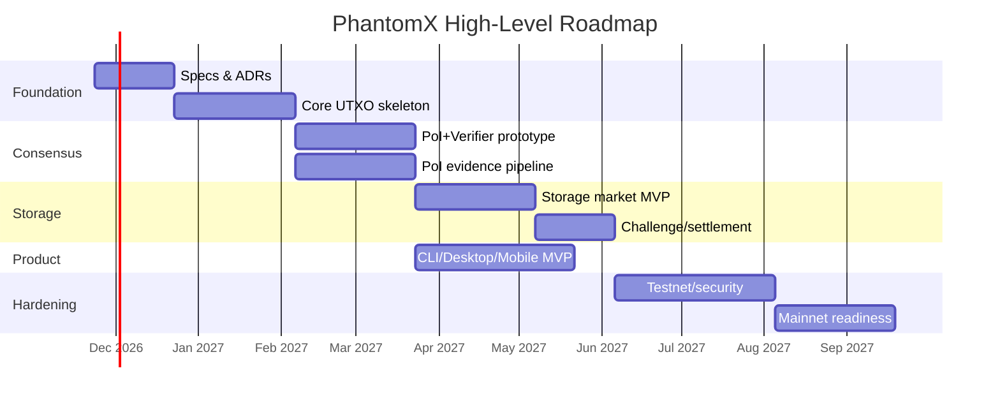

# PHANTOMX ROADMAP

> **NOTE (PoI+Verifier removed):** PhantomX consensus/finality has moved to **PoI + Verifier attestation**. Any remaining PoI+Verifier/verifier wording in this document is historical and must not be used to reintroduce PoI+Verifier.

## Planning Baseline

This roadmap translates the PhantomX requirements into phased delivery. It is a technical plan, not a commitment to dates. Each phase exits only when acceptance criteria are met and evidence (tests, logs, docs) is recorded.

## Guiding Constraints

- Independent L1: no PhantomX/Dogecoin fork/copy.
- Consensus: PoI + Verifier attestation finality; no PoSpace/VDF/PoT.
- No storage mining, storage marketplace, HDD mining, or storage reward in initial scope.
- Deterministic accounting: integer phx_atom, no floating point in consensus.
- Security claims require tests.

## Phase Map

*Dates are placeholders for sequencing only; replace with approved schedule.*

## Phase 0 — Research and Specification

**Goal:** lock protocol boundaries and produce implementation-ready specs.

**Deliverables:**
- Finalized architecture/spec docs (this PROMPT 01 set).
- ADRs: PoI+Verifier family, voting power, DB, crypto, serialization, P2P, storage proof, Qt licensing.
- Threat model: PoI spoofing/replay/collusion, PoI+Verifier equivocation, storage fraud, key compromise, RPC exposure.
- Genesis/tokenomics spec with integer test vectors.

**Exit criteria:**
- All consensus-critical rules have deterministic pseudocode.
- Tokenomics test vectors pass in spec review.
- No unresolved "TBD" for MVP consensus/state transitions.

## Phase 1 — Core Ledger and Node Skeleton

**Goal:** build deterministic C++ core for UTXO chain without PoI/PoI+Verifier complexity.

**Work items:**
- Canonical types, serialization, hashing, key/signature wrappers.
- UTXO DB, transaction validation, mempool basics.
- Block structure, block validation, chainstate application.
- Native C++ CLI for keygen, tx create/sign/broadcast, node run.
- Unit/integration tests; deterministic replay.

**Exit criteria:**
- Deterministic block replay across machines.
- Integer accounting tests cover subsidy/halving/remainder/fee cases.
- No floating-point in consensus path (lint/static check).

## Phase 2 — PoI+Verifier Finality

**Goal:** implement finality layer with verifier identities, votes, QCs.

**Work items:**
- Verifier registry, key separation, epoch/committee management.
- Proposer selection, vote messages, quorum certificate aggregation/verification.
- Timeout/view change, equivocation evidence handling.
- Finality-aware sync/checkpointing.
- Adversarial tests: equivocation, conflicting QCs, delayed network.

**Exit criteria:**
- Safety tests pass under <1/3 Byzantine simulated verifiers.
- Liveness tests pass under partial synchrony simulation.
- Finalized blocks never roll back in test harness.

## Phase 3 — PoI Evidence and Scoring

**Goal:** implement PoI as evidence-based eligibility/contribution scoring.

**Work items:**
- Verifier registration and challenge scheduler.
- Bandwidth/uptime/latency/relay challenge-response protocols.
- Signed evidence format, nonce/freshness/replay protection.
- Independent verification/cross-verification rules.
- Score normalization (0-100) with integer fixed-point math.
- Pool reporting with anti-self-verification rules.

**Exit criteria:**
- Replay/stale/unsigned evidence rejected.
- Pool self-verification attempts rejected.
- Score calculation deterministic and matches test vectors.
- PoI subsystem explicitly marked non-Sybil-resistant in docs/UI.

## Phase 4 — Decentralized Storage Network MVP

**Goal:** deliver real storage lifecycle and fee settlement.

**Work items:**
- Client-side encryption, chunking, content addressing, manifest.
- Provider registration, capacity metadata, assignment, replication.
- Lease contracts, storage challenge, retrieval challenge, integrity verification.
- Storage fee escrow, settlement, expiration, deletion.
- Provider availability scoring and penalty hooks.

**Exit criteria:**
- End-to-end store/retrieve/delete flow passes on testnet.
- Invalid/missing storage proofs cause penalty/no-pay outcome.
- No code path rewards empty HDD capacity.
- Storage provider payments come only from storage fees.

## Phase 5 — Product Surfaces

**Goal:** usable interfaces for operators and users.

**Work items:**
- Qt desktop: wallet, node status, PoI dashboard, storage deal dashboard.
- Native C++ CLI: full node/wallet/verifier/provider/admin commands.
- Android/iOS: wallet, balance, tx history, basic monitoring/light mode.
- Independent monitoring backend/frontend: blocks, txs, finality, PoI, fee settlement.

**Exit criteria:**
- CLI commands documented and tested.
- Desktop/mobile do not expose private keys or plaintext files.
- Monitoring UI displays finalized state and storage/payment trails.

## Phase 6 — Security Hardening and Testnet

**Goal:** adversarial testing before mainnet.

**Work items:**
- Fuzzing: P2P, serialization, tx, PoI evidence, storage proofs.
- Sanitizers and static analysis in CI.
- Economic simulation: reward split, halving, storage fee market, verifier incentives.
- Penetration testing: RPC, key stores, wallet.
- Public testnet with telemetry and bug bounty scope.

**Exit criteria:**
- Critical/high vulnerabilities resolved or mitigated.
- Consensus/property tests stable over long-run soak.
- Reproducible build and release signing process documented.

## Phase 7 — Mainnet Readiness

**Goal:** controlled launch.

**Work items:**
- Genesis configuration and checksum publication.
- Release candidates, upgrade/rollback procedures.
- Operator documentation: verifier, verifier, aggregator, pool.
- Incident response and monitoring runbooks.

**Exit criteria:**
- Mainnet checklist approved.
- Independent review of tokenomics/consensus/storage rules completed.
- Backup/recovery and finality monitoring validated.

## Cross-Cutting Workstreams

| Workstream | Applies to | Key artifacts |
|---|---|---|
| Protocol specs | All phases | ADRs, state machines, message schemas, test vectors |
| Security | All phases | Threat model, fuzzing, audits, key management |
| Testing | All phases | Unit, integration, property, adversarial, soak, CI reports |
| DevOps/release | Phases 1-7 | Reproducible builds, SBOM, signed artifacts, deployment runbooks |
| Documentation | All phases | Operator guides, RPC docs, architecture updates, changelog |

## Initial Backlog (PROMPT 02+ candidates)

1. Create C++ CMake skeleton with `core/`, `node/`, `cli/`, `tests/`, `docs/`.
2. Define canonical serialization and PHX amount types (`phx_atom`).
3. Implement UTXO transaction/block primitives and deterministic unit tests.
4. Draft PoI+Verifier message schema and verifier state machine.
5. Draft PoI evidence schema and verifier challenge protocol.
6. Draft storage deal/manifest/proof schema.